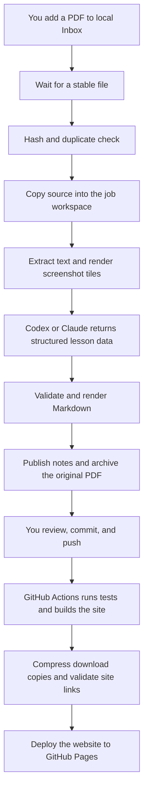

# DarwinGlish: PDF → Obsidian

A manually started job watches an Inbox folder, reads English-learning PDFs using **Codex or Claude Code**, creates grammar notes and exercises, then renames and organizes the source PDF. Screenshot-only PDFs are supported through rendered page images.

## 1. Libraries and tools

| Dependency | Purpose | Installation |
| --- | --- | --- |
| **Python 3.11+** | Runs the scripts | Install Python for your OS |
| **PyMuPDF** | Preferred PDF text extraction and image rendering | `python -m pip install -r requirements.txt` |
| **Codex CLI or Claude Code CLI** | Analyzes text/images and returns lesson data | Install one CLI and authenticate it separately |
| **Bash** | Linux/macOS launcher | Normally included on Linux/macOS |
| **PowerShell** | Windows launcher | Run `config/start.ps1` in PowerShell |
| **markdown-it-py** | Website rendering only | `python -m pip install -r requirements-site.txt` |
| **Ghostscript + Poppler** | Optional smaller website PDF downloads | Installed by the Pages workflow; local builds fall back to originals if absent |

The remaining modules are in Python's standard library: `argparse`, `contextlib`, `hashlib`, `json`, `logging`, `os`, `pathlib`, `re`, `shutil`, `signal`, `subprocess`, `sys`, `time`, `tomllib`, plus `fcntl` on Unix or `msvcrt` on Windows for the job lock. Tests additionally use `unittest`, `tempfile`, `copy`, and `zlib`.

**Optional fallback:** when PyMuPDF is unavailable, the job uses Poppler's `pdfinfo`, `pdftotext`, and `pdftoppm` if all three are on PATH. Install PyMuPDF for a simpler Windows/macOS setup. There is no requirement for OCR/Tesseract, `watchdog`, `python-dotenv`, or an OpenAI/Anthropic Python SDK.

The selected CLI must support image input, noninteractive execution, and structured output. Its selected model must support images. Your existing CLI account/API authentication and usage limits apply. `--check` checks executable availability, not authentication or remaining quota. Source text and image tiles are sent to the provider during a real analysis.

Official references: [Codex noninteractive mode](https://learn.chatgpt.com/docs/non-interactive-mode), [Claude Code programmatic mode](https://code.claude.com/docs/en/headless).

## 2. Project structure

```text
DARWINGLISH/
├── README.md
├── requirements.txt
├── requirements-site.txt              # Website-only dependency
├── .github/workflows/pages.yml         # Deploy after your push
├── scripts/                          # Python only
│   ├── watch_pdfs.py                  # CLI, polling, state, publication, recovery
│   ├── pdf_input.py                   # PDF text extraction and image tiling
│   ├── providers.py                   # Codex and Claude CLI adapters
│   ├── lesson_output.py               # Result validation and Markdown rendering
│   ├── build_site.py                  # Markdown/wiki links → static HTML
│   ├── compress_pdfs.py               # Smaller PDF download copies
│   ├── site_validation.py             # Website file/heading/download checks
│   ├── site_assets/                   # CSS and browser JavaScript
│   └── tests/                        # Watcher and website behavior tests
├── content/                          # Open THIS folder as your Obsidian vault
│   ├── .obsidian/                     # Existing vault settings, preserved and relocated
│   ├── Inbox/                        # Put new PDFs here
│   ├── PDFs/                         # Existing PDFs plus newly organized originals
│   ├── Obsidian English/             # Existing study notes
│   │   ├── Imported Lessons.md        # Automatically maintained import index
│   │   └── Imported/<topic>--<hash>/  # One generated bundle per new PDF
│   │       ├── Lesson.md
│   │       ├── Exercises.md           # All answers are at the end
│   │       └── manifest.json
│   ├── Duplicates/                    # Repeated PDFs retained without another AI call
│   └── References/                    # Existing standalone screenshots
└── config/
    ├── job.toml                      # Shared job settings
    ├── site.toml                     # Website and PDF compression settings
    ├── linux.env                     # Linux Bash overrides
    ├── macos.env                     # macOS Bash overrides
    ├── windows.ps1                   # Windows environment overrides
    ├── start.sh                      # Bash launcher
    ├── start.ps1                     # PowerShell launcher
    ├── skills/english-pdf-notes/
    │   ├── SKILL.md                  # Reusable conversion instructions
    │   └── schema.json               # Structured result contract
    └── state/                        # Created at runtime; ignored by Git
        ├── job.lock
        ├── job.log
        ├── history.json
        ├── previews/                 # --prepare-only output
        └── jobs/<full-sha256>/        # Prompt, result, plan, provider logs
```

The original six PDFs and 22 Markdown notes were moved into `content/`. Their PDF wiki links remain relative to the vault root. The existing `.obsidian` settings now live at `content/.obsidian`; workspace note paths were adjusted for the new location. Reopen **content/** as the vault if Obsidian still points at the previous notes-only folder.

## 3. Install

Run these commands from the project folder. Do not put credentials in the config files; use your CLI's normal login.

### Linux or macOS

```bash
python3 --version                    # Must be 3.11 or newer
python3 -m venv .venv
.venv/bin/python -m pip install -r requirements.txt
```

On Debian/Ubuntu, if creating the virtual environment reports that `ensurepip` is unavailable, install the appropriate `python3-venv` package first. An existing pip can also manage a virtual environment without its own pip using `python3 -m pip --python .venv/bin/python install -r requirements.txt`. Package installation requires network access.

If all three Poppler tools are already installed, you can run using that fallback without installing a Python package.

### Windows PowerShell

```powershell
python --version                    # Must be 3.11 or newer
python -m venv .venv
.\.venv\Scripts\python.exe -m pip install -r requirements.txt
```

Install Codex or Claude Code using its official instructions, then sign in interactively. The executable must be callable from Python without a shell; use a native executable path in `job.toml` when necessary. A shell alias/function is not an executable. The launchers use the project's virtual-environment Python when present; otherwise Bash uses `PYTHON_COMMAND`/`python3`, and PowerShell uses `python` on PATH.

## 4. Activate the job

### Linux/macOS: Bash

```bash
bash config/start.sh --check
bash config/start.sh --provider codex
# Or:
bash config/start.sh --provider claude
```

### Windows: PowerShell

```powershell
.\config\start.ps1 --check
.\config\start.ps1 --provider codex
# Or:
.\config\start.ps1 --provider claude
```

If your Windows execution policy blocks the launcher, review/trust the local script and configure a policy appropriate to your machine. You can also call the Python entry point directly:

```powershell
.\.venv\Scripts\python.exe .\scripts\watch_pdfs.py --provider claude
```

The job runs **in the foreground**. Leave that terminal open. **Press Ctrl+C to stop.** Closing the terminal also ends the watcher, though Ctrl+C allows orderly cleanup. The foreground launchers do not install a startup service. For event-triggered Linux activation, use section 12.

Once it is running:

1. Copy or move a PDF into `content/Inbox/`.
2. Wait for its size and modification time to remain unchanged for `stable_seconds` (default 10 seconds).
3. The job extracts text, renders low-text pages into overlapping image tiles, and invokes the selected provider.
4. It validates structured output, publishes the Markdown bundle, archives the PDF under its generated name, and removes that successfully archived Inbox copy.
5. Open `content/Obsidian English/Imported Lessons.md` in Obsidian.

Only direct children of Inbox with a `.pdf` extension (case-insensitive) are watched. It is not recursive. Use a temporary extension such as `.part` while downloading, then rename to `.pdf` when complete; this avoids a long pause during copying being mistaken for a completed file. Symlink inputs are ignored.

Example result:

```text
content/Inbox/screencapture_123.pdf
  → content/PDFs/Grammar/second-conditional--a1b2c3d4e5f6.pdf
  → content/Obsidian English/Imported/second-conditional--a1b2c3d4e5f6/Lesson.md
  → content/Obsidian English/Imported/second-conditional--a1b2c3d4e5f6/Exercises.md
```

The suffix is the first 12 characters of the source file's SHA-256. The full hash is recorded in the manifest and processing history.

## 5. Useful commands

| Purpose | Bash | PowerShell |
| --- | --- | --- |
| Check configuration/tools | `bash config/start.sh --check` | `.\config\start.ps1 --check` |
| Watch with Codex | `bash config/start.sh --provider codex` | `.\config\start.ps1 --provider codex` |
| Watch with Claude | `bash config/start.sh --provider claude` | `.\config\start.ps1 --provider claude` |
| Process one stable inbox snapshot, then exit | `bash config/start.sh --once` | `.\config\start.ps1 --once` |
| Reset failed attempts and try again | `bash config/start.sh --once --retry-failed` | `.\config\start.ps1 --once --retry-failed` |
| Show command help | `bash config/start.sh --help` | `.\config\start.ps1 --help` |

Test PDF preparation **without an agent call or PDF move**:

```bash
bash config/start.sh --prepare-only "content/PDFs/Grammar/04 Cause and Result/Making time work.pdf"
```

```powershell
.\config\start.ps1 --prepare-only 'content\PDFs\Grammar\04 Cause and Result\Making time work.pdf'
```

This creates `pages.json` and any rendered PNGs under `config/state/previews/`. Stop another running watcher before preparing a preview; these commands share the single-job lock.

`--once` waits for the stability interval and processes one snapshot. Files that change during that interval wait for a later run. A considered file that fails or remains retry-blocked makes the command exit with status 1. Ctrl+C exits with status 130. `--check` and `--prepare-only` do not verify provider inference.

## 6. User configuration

Edit `config/job.toml` to set the default provider, optional model, Inbox location, limits, executable paths, and timing.

```toml
provider = "codex"           # or "claude"
model = ""                   # empty uses the CLI's configured default
inbox = "content/Inbox"
poll_seconds = 5
stable_seconds = 10
max_attempts = 2
retry_seconds = 60
agent_timeout_seconds = 900
```

All configured directories must be inside this project; Inbox must be a subdirectory of `content`, and state must remain separate. Relative paths resolve from the **project root**, regardless of the terminal's current directory. Only one configured state directory should manage a given Inbox. Do not start two copies with separate state directories against the same Inbox.

For OS-specific overrides, edit `config/linux.env`, `config/macos.env`, or `config/windows.ps1`. For example:

```bash
# Linux/macOS, or put these exports in the matching .env file:
export ENGLISH_PROVIDER=claude
export ENGLISH_MODEL=""       # Or a model available to your account that supports images
bash config/start.sh
```

```powershell
$env:ENGLISH_PROVIDER = 'claude'
.\config\start.ps1
```

Precedence: **`--provider` > nonempty `ENGLISH_PROVIDER` > `job.toml`**. A nonempty `ENGLISH_MODEL` overrides the TOML model. `ENGLISH_CONFIG` selects a different TOML file; Bash also accepts `PYTHON_COMMAND` when no project virtual environment exists. `codex_command`/`claude_command` each take one executable name or path, not a shell command containing arguments.

Restart the watcher after changing settings. When retrying an already analyzed job with a saved publication plan, the existing result/provider is reused; selecting a different provider does not replace that saved analysis.

## 7. Reusable skill and note behavior

Both provider adapters explicitly load `config/skills/english-pdf-notes/SKILL.md`. The instructions are project-local and need no installation in your global Codex or Claude configuration. They are also readable and reusable in manual sessions: ask the agent to use that file for an English PDF conversion. Automatic global skill discovery is not configured by these launchers.

The skill requests:

- Grammar usage, contrasts, common mistakes, source examples, and clearly labelled new examples.
- Related links selected from the existing note catalog.
- Visible source exercises, including choices and blanks.
- Clearly labelled adapted/new practice when the PDF does not supply the requested task type.
- Separate answers and explanations, rendered **after all questions**, in the final `Answers` section at the end of the exercise note.
- Explicit limitations for clipped screenshots, missing prompts, unreadable areas, unavailable audio, and inferred answers.

Python validates the result's shape, page references, related-note targets, and filename slug. It creates the links and performs file operations. Codex runs in a read-only sandbox; Claude is limited to its Read tool for local images. Neither is asked to rename files or edit the vault. Structural checks cannot prove the linguistic accuracy of an answer, so review generated lessons normally.

Existing authored notes are preserved. New imports get their own bundle and appear in a generated index; the job does not automatically merge them into old topic notes. The agent sees the catalog for linking, not the full text of every old note.

## 8. Recovery, duplicates, and limits

- **Duplicates:** after a hash was successfully processed by this job, a new copy is moved to `content/Duplicates/` without another provider call. PDFs already in `content/PDFs` are not automatically indexed into processing history.
- **Failures:** the Inbox source stays in place through agent/preparation/validation failures. The job records an error and retries up to `max_attempts`, separated by `retry_seconds`. Inspect the logs before using `--retry-failed`.
- **Interrupted publication:** a saved plan is reused without another AI call. A matching archived PDF and verified note bundle let the next run recover completed state. A hard interruption during a PDF copy can leave a partial destination; inspect/move that partial file aside before retrying. The original is retained until a verified archive exists.
- **Collisions/edits:** existing destination files are never overwritten. If notes in an incomplete publication were edited manually, a retry stops instead of replacing those edits.
- **Limits:** default maximums are 80 pages, 60 image tiles, and 400,000 extracted text characters. Exceeding a limit fails explicitly; pages are not silently discarded. Split large PDFs or change the limits to fit the provider's context/image capacity.
- **PDF support:** password-protected PDFs must be unlocked first. Low-text pages are rendered; text-rich pages use extracted text. Diagrams on text-rich pages are not separately interpreted in this version. Extremely small screenshot text may require a larger `image_width`.
- **Logs/state:** `config/state/job.log` summarizes activity. Each job directory stores source-containing prompts/results and provider stdout/stderr. Work images and the temporary PDF copy are removed after successful processing; failed-job work and preparation previews remain for diagnosis. You can remove previews and successful-job logs while the watcher is stopped. Keep `history.json` and publication plans if you want deduplication/recovery.
- **Concurrency:** a file lock prevents two processes from using the same state directory. It releases on exit; the lock file remaining on disk is normal.

Do not delete all processing history to fix one failed file: that loses duplicate tracking for other imports. Errors and attempts are keyed by the full PDF hash in `history.json`.

## 9. Tests and validation status

Run the behavior tests without paid agent calls (install both requirements files for the complete suite):

```bash
python3 -m unittest discover -s scripts/tests -v
```

```powershell
python -m unittest discover -s scripts/tests -v
```

Tests use temporary directories and simulated provider responses. They cover publication, final answer placement, bounded retries, duplicates, source preservation, collision handling, interrupted publication/recovery, edited-note preservation, lock contention, file stability, symlink inputs, invalid results, both CLI adapters, and real text/image PDF preparation when a backend is available.

Validated here on Linux: 17 behavior tests, both CLI executable checks, Bash syntax, real screenshot preparation, and the 22-page IELTS PDF preparation using the Poppler fallback. The skill passed its frontmatter/name validator. PyMuPDF installation could not complete in this environment because package-network access was unavailable. Windows/PowerShell and macOS launchers have not been executed here. No real Codex/Claude inference, account authentication, or output quality test was performed; run your first real import with `--once` and inspect the generated bundle before leaving the watcher running.

## 10. GitHub Pages: enable the website

Your publication workflow is deliberately separate from local AI processing:

```text
Local Inbox → local Codex/Claude processing → your review → your Git commit and push
→ GitHub Actions → GitHub Pages
```

The new `.github/workflows/pages.yml` workflow builds the website and deploys it. It **never commits, pushes, or invokes an AI provider**. No model credentials are needed in GitHub Actions.

### One-time GitHub setup

1. Create/open the GitHub repository that will contain this project. The workflow currently targets **main**. If your publishing branch has another name, change both `branches: [main]` and the `github.ref == 'refs/heads/main'` condition in `.github/workflows/pages.yml`.
2. In the repository, go to **Settings → Pages**.
3. Under **Build and deployment → Source**, select **GitHub Actions**. Do not select a branch or `/docs` source: this workflow uploads the generated `dist` artifact.
4. If Actions is disabled, enable it in **Settings → Actions → General**. Organization policies may need to allow the official `actions/*` actions. The workflow declares its required permissions; it does not need repository-content write access.
5. Review and commit the implementation and your finished content yourself, then push to the publishing branch. For the first setup, an example is:

   ```bash
   git status
   git add .github scripts config content README.md requirements.txt requirements-site.txt .gitignore
   git diff --cached --stat
   git commit -m "Add English library website and GitHub Pages pipeline"
   git push origin main
   ```

   If this is a new local repository, connect it to your GitHub repository before pushing. Use your own repository URL and authentication. No Git commands have been run to commit or push on your behalf.

6. Open the repository's **Actions** tab and select **Publish English library**. The build runs tests, compresses download copies, checks website links, and uploads the site; the deploy job publishes it.
7. Open **Settings → Pages → Visit site**, or the deployment URL shown by the workflow. A project site is normally `https://YOUR-USERNAME.github.io/YOUR-REPOSITORY/`.

If the first push happened before Pages was enabled, enable Pages and rerun the failed workflow, or use **Actions → Publish English library → Run workflow**, selecting `main`.

GitHub Pages availability depends on your repository visibility and plan. A public repository on GitHub Free is supported. See [GitHub's Pages publishing documentation](https://docs.github.com/en/pages/getting-started-with-github-pages/configuring-a-publishing-source-for-your-github-pages-site) and [custom workflow documentation](https://docs.github.com/en/pages/getting-started-with-github-pages/using-custom-workflows-with-github-pages).

### Publish newly added lessons

1. Start the local watcher using section 4.
2. Put the new PDF in `content/Inbox/` and wait for local processing to finish.
3. Review the generated notes, exercises, and PDF under `content/`.
4. Commit and push your reviewed content:

   ```bash
   git add "content/Obsidian English" content/PDFs
   git diff --cached --stat
   git commit -m "Add a new English lesson"
   git push origin main
   ```

5. The website updates after the GitHub Actions deployment succeeds. A local commit without a push does not publish anything.

Only changes matching the workflow's content/build paths trigger an automatic build. Documentation-only changes do not require a website rebuild. You can also run the workflow manually for already committed content. Editing files in Inbox does not trigger GitHub or an upload.

### What gets published

The website includes:

- All non-hidden `.md` files under `content/Obsidian English/`.
- PDF distribution copies made from files under `content/PDFs/`.
- The CSS/JavaScript in `scripts/site_assets/`.
- A small compression report.

The builder does not copy the whole repository or vault. Inbox files, duplicates, standalone reference images, `.obsidian`, `.processing`, provider prompts/logs, runtime state, configuration, and the Python scripts are outside the website allowlist. `.gitignore` additionally excludes local Inbox files, state, generated `dist`, Obsidian settings, and duplicates from new Git tracking.

The site supports searchable/filterable notes, working Obsidian wiki links and heading links, tables, source callouts, and expandable answer sections. Generated links use relative URLs, so both repository project sites and account-root Pages sites work. Broken or ambiguous note links fail the build rather than publishing broken navigation. The last successful deployment stays live if a subsequent build fails.

All published PDF links use same-origin URLs and the HTML `download` attribute, with no page fragment and no embedded viewer. Clicking a PDF requests a file download; the browser controls save prompts and download preferences. This includes PDF links inside lesson notes and on the PDF bookshelf. Reference: [HTML download behavior](https://developer.mozilla.org/en-US/docs/Web/HTML/Reference/Elements/a#download).

### Build or preview locally

The website needs one extra Python library, kept separate from the PDF watcher's dependencies:

```bash
python3 -m pip install -r requirements-site.txt
python3 scripts/build_site.py
python3 -m http.server 8000 --directory dist
```

Then visit `http://localhost:8000`. If you use the virtual environment, run these commands with `.venv/bin/python` on Linux/macOS or `.\.venv\Scripts\python.exe` on Windows. On Windows without a virtual environment, use `python` in place of `python3`.

`config/site.toml` controls the site title/tagline, input folders, compression quality, and output directory. Only the generated `dist/` directory is uploaded. You do not need to commit `dist/`; GitHub rebuilds it from your committed Markdown and original PDFs.

For a fast build without recompression:

```bash
python3 scripts/build_site.py --no-compress
```

`build_site.py` rejects output directories overlapping source/configuration folders and refuses to replace a nonempty directory it did not create. Notes use CommonMark plus tables, Obsidian wiki links, and basic callout conversion. Plugins such as Dataview, math rendering, arbitrary HTML, and attachment image embeds are not implemented; unsupported image attachments or unresolved links stop the build with a diagnostic.

### Smaller PDFs

Compression happens **at website build time**, on separate download copies. Original PDFs in `content/PDFs` and their source hashes are preserved. This reduces website downloads, not the Git repository's original-file size.

The build uses Ghostscript with JPEG quality **90**, a **220 DPI** target for high-resolution color/grayscale images, and no monochrome downsampling. It preserves PDF page geometry. A candidate is used only when it is at least 2% smaller and checks preserve page count, dimensions, and normalized extracted text. Otherwise, the original is copied into the website. Compression may be lossy for images; increase `jpeg_quality`/`image_dpi` or disable it in `config/site.toml` if a particular screenshot needs more detail.

GitHub Actions installs Ghostscript and Poppler automatically. Locally, the builder looks for `gs`, `gswin64c`, or `gswin32c`, plus `pdfinfo` and `pdftotext`. If they are absent, the site still builds using original PDF copies. No system packages are installed by the Python scripts.

For separate download copies outside the website build:

```bash
python3 scripts/compress_pdfs.py --input content/PDFs --output config/state/pdf-download-copies
```

Initial six-PDF measurement:

| PDF | Original | Website download |
| --- | ---: | ---: |
| Getting along | 4.65 MB | 0.48 MB |
| Open source | 6.74 MB | 0.49 MB |
| Presenting a project update | 1.80 MB | 1.55 MB |
| Making time work | 3.64 MB | 2.63 MB |
| IELTS common idioms | 1.15 MB | 1.15 MB |
| Why do we trust it so much? | 5.31 MB | 2.59 MB |
| **Total** | **23.29 MB** | **8.89 MB** |

That is approximately **61.8% smaller** overall. The IELTS candidate did not satisfy the preservation checks, so its original is served unchanged. `dist/compression-report.json` records the actual result after each build.

### Website validation

Install `requirements-site.txt` before running the full suite; `requirements.txt` alone is sufficient only for the watcher portion. Run watcher-only tests with `python3 -m unittest discover -s scripts/tests -p test_job.py` if you do not need the site builder.

The complete suite includes **31 watcher/site tests** plus the service tests described in section 12. Website coverage includes note/heading links, relative project-site URLs, downloadable PDFs, collapsible answers, wiki aliases in tables, excluded local data, failed-build preservation, output directory protection, raw HTML escaping, ambiguous imports, and compression fallback/preservation behavior.

The generated site was built locally with all 23 notes and 6 PDFs. All 31 PDF pages were rendered; detailed compressed grammar sections were visually inspected. Browser preview could not run in this environment because opening a local HTTP socket was denied. The GitHub Actions deployment itself has not run here; it will run after your commit/push and Pages setup.

## 11. Detailed execution workflow

There are two independent processes. The **local job creates study content**; the **GitHub workflow publishes content you have committed and pushed**.



### A. Starting and observing the local job

1. `config/start.sh` or `config/start.ps1` locates the project, loads the OS-specific overrides, selects Python, and calls `scripts/watch_pdfs.py`.
2. `main()` parses command-line arguments and `load_config()` reads `config/job.toml`. Provider selection follows command line → environment → TOML.
3. `job_lock()` acquires the single-job lock. A second process using that state directory exits instead of processing the same Inbox concurrently.
4. The job checks the PDF backend and selected CLI executable, loads `history.json`, recovers completed publications interrupted before state recording, and rebuilds the import index.
5. `Job.ready()` polls the direct children of Inbox. It accepts regular, non-symlink `.pdf` files regardless of extension capitalization.
6. A file becomes eligible after its size and modification timestamp remain unchanged across observations for `stable_seconds`. Changing files restart that waiting period. A final `.pdf` rename after downloading to a `.part` file is the most reliable handoff.

`--once` performs the stability wait and processes one snapshot, then exits. Normal mode keeps polling until you stop it. `--check` only checks configuration/tools. `--prepare-only` only prepares one PDF and never invokes an agent or archives that source.

### B. Identifying and preparing one PDF

| Step | Code | Result |
| --- | --- | --- |
| Identify source | `lesson_output.sha256()` | Full content hash, independent of the filename |
| Check history | `Job.process()` | Determines whether to process, wait for retry, or retain a duplicate |
| Retain a duplicate | `Job.duplicate()` | Moves a new copy of an already processed PDF to `content/Duplicates` without another AI call |
| Record attempt | `Job.save()` | Persists running status and the attempt count |
| Make a working snapshot | `copy_exclusive()` | Creates and hash-checks `config/state/jobs/<hash>/work/input.pdf` |
| Read the document | `pdf_input.prepare()` | Returns page text, page numbers, rendered-image paths, and backend name |

If a saved publication plan already exists, the job resumes that plan rather than preparing the PDF and paying for another analysis.

During preparation:

- PyMuPDF is preferred when installed. Otherwise, the optional Poppler fallback uses `pdfinfo`, `pdftotext`, and `pdftoppm`.
- Each page gets a record with its 1-based PDF page number and extracted text.
- A page with fewer than `text_threshold` non-whitespace text characters is rendered as images. Tall pages are split into overlapping tiles so small screenshot text can be inspected.
- Text-rich pages are represented by extracted text. The current version does not separately interpret illustrations on such pages.
- Page, text, and image limits are checked. Exceeding a limit fails the job rather than silently omitting content.
- The PDF handle is closed when preparation finishes or fails.

### C. What `pages.json` contains

`pages.json` is a local preparation manifest. It records the text and image-tile mapping for inspection and troubleshooting. For example:

```json
[
  {
    "page": 1,
    "text": "",
    "images": [
      "page-001-y-000000.png",
      "page-001-y-001480.png"
    ]
  },
  {
    "page": 2,
    "text": "Grammar explanations extracted from this page.",
    "images": []
  }
]
```

The example represents an image-only first page and a text-rich second page. The `y` value identifies the tile's vertical offset in rendered pixels. Images are listed in reading order; overlaps are not separate source pages.

The JSON-writing step in `pdf_input.py` is now separated into readable statements:

```python
manifest_path = work / 'pages.json'
manifest_json = json.dumps(pages, ensure_ascii=False, indent=2)
manifest_path.write_text(manifest_json, encoding='utf-8')
```

`json` is imported at the **top of the module**. `ensure_ascii=False` keeps accented and other Unicode characters readable, `indent=2` formats the manifest, and UTF-8 defines its file encoding.

The watcher builds the agent prompt from the preparation result **already in memory**; it does not reopen `pages.json`. The manifest is a diagnostic record, not an extra processing stage. It lives inside the job workspace, is removed with that workspace after success, and is never included in the website.

### D. Agent analysis and Markdown creation

1. `catalog()` gathers the existing Markdown note paths for related-topic links. It does not send the full contents of all previous notes.
2. `make_prompt()` combines the reusable skill, page count, page text, image manifest, and allowed related-note catalog. A local `prompt.txt` records this input.
3. `providers.run_agent()` invokes the selected CLI:
   - **Codex:** attaches the PNG tiles, requests the JSON schema, and runs with a read-only sandbox. The CLI writes its final structured response to `raw-response.json`.
   - **Claude:** receives the text in its prompt and uses the allowed Read tool to inspect the listed local images. The adapter extracts the response's `structured_output` object.
4. The provider timeout bounds the call. A failure, missing structured output, or invalid JSON fails the attempt. The job keeps stdout/stderr logs for diagnosis.
5. `lesson_output.validate()` checks fields, allowed categories, filename slug, source-page ranges, related-note targets, exercise choices, and required grammar sections. This validates structure and references; it does not prove every grammar explanation or answer is correct.
6. `lesson_output.render()` produces `Lesson.md` and `Exercises.md`. Python constructs links and metadata, places all questions before the final answer key, and preserves the source/adapted/added exercise distinction.
7. The job saves `result.json` and `plan.json` before publication. The plan records the output paths and complete Markdown text, allowing interrupted publication to resume without another agent call.

### E. Local publication and recovery

`publish()` rechecks the Inbox source hash, creates a staged bundle under `content/.processing/<hash>`, and then publishes it under `content/Obsidian English/Imported/<topic>--<hash-prefix>/`.

The bundle's `manifest.json` records its source hash and generated-file hashes. The job verifies that bundle before copying the PDF to `content/PDFs/<category>/<topic>--<hash-prefix>.pdf`. The original filename remains in metadata and processing history. Existing conflicting destination files are not overwritten.

Only after the archived PDF is verified and the Inbox file is rechecked does the job remove that Inbox copy. It marks the job complete, rebuilds `Imported Lessons.md`, and removes temporary working images/text/PDF copies. Prompts, results, plans, and logs remain in the ignored state directory.

If an attempt fails before archiving, the original normally remains in Inbox. Retries respect the configured delay and attempt limit. Startup recovery can recognize a fully published bundle and archived PDF when an interruption happened before completion was recorded. Partial archive copies and manually edited incomplete bundles need inspection; a retry stops rather than replacing conflicting content.

This finishes the **local** workflow. It does not run Git.

### F. Your commit and the GitHub publication workflow

After reviewing the local output, **you** stage, commit, and push it. `.github/workflows/pages.yml` responds to matching changes pushed to `main`, or to your manual workflow dispatch.

| GitHub stage | What it does | What it reads/writes |
| --- | --- | --- |
| Checkout | Retrieves your committed project revision | Repository → runner workspace |
| Python setup | Selects Python 3.12 and restores package cache | Runner environment |
| Dependency setup | Installs `requirements-site.txt`, Ghostscript, and Poppler | Runner environment |
| Behavior tests | Runs watcher and website tests with simulated agent responses | Temporary test workspaces; no paid AI calls |
| Pages configuration | Reads the Pages configuration | GitHub Pages metadata |
| Site build | `build_site.py` reads allowed notes/PDFs, renders HTML, and generates relative links | Committed content → temporary build directory |
| PDF optimization | `compress_pdfs.py` creates distribution copies and checks them | Original PDFs → website download copies; originals unchanged |
| Site validation | `site_validation.py` checks local assets, heading targets, and PDF download attributes | Generated website |
| Artifact upload | Packages the successful `dist/` build | Runner build → Pages artifact |
| Deployment | `actions/deploy-pages` publishes that artifact | Pages artifact → website URL |

The build job has repository-content read access and Pages read access. The deploy job receives Pages write access and an identity token; it depends on the successful build. Concurrency settings cancel an older run when a newer publication starts.

All PDF links point to the website's own download copies with a `download` attribute. A failed build does not replace the last successful deployment. The workflow has no step that creates commits, pushes changes, or analyzes a local Inbox.

### G. Python import convention

Imports belong at module scope, grouped as standard library, third-party packages, and project modules. No imports remain inside functions or methods.

Optional and platform-specific dependencies are selected **at module scope**:

- `pdf_input.py` optionally imports PyMuPDF at the top. If the package is absent, it can use Poppler. A different missing dependency inside an installed PyMuPDF package is surfaced rather than hidden.
- `watch_pdfs.py` imports `msvcrt` on Windows or `fcntl` on Unix at the top. `job_lock()` only uses the selected module; it does not import it while acquiring the lock.

This makes dependencies visible when opening a module and keeps processing functions focused on their actual work.

## 12. Linux: run only when Inbox changes

For low idle memory use, use the **systemd user path unit**, rather than leaving the Python polling watcher running. systemd monitors filesystem events through inotify and starts a one-shot service for an Inbox change. Bash replaces itself with the Python process, the job processes one stable snapshot, and the process exits. There is no dedicated Bash/Python/agent daemon left running while idle.

```text
Idle: systemd monitors Inbox; no Python or agent job is running
New file/change: systemd starts start.sh --once
Active: the job prepares and processes stable PDFs sequentially
Finished: Python and the agent exit; systemd continues monitoring
```

This mode is Linux-specific. The existing Bash and PowerShell foreground launchers remain available on other systems.

### Enable it

Stop any foreground watcher first with Ctrl+C. From the project root, run:

```bash
# Optional: render the units inside the project for inspection only.
bash config/service.sh generate

# Install the units for your user and enable event monitoring.
bash config/service.sh install

# Confirm that the path watcher is active.
systemctl --user status darwinglish-inbox.path
```

`generate` writes only `config/systemd/generated/`. `install` copies the generated units into `${XDG_CONFIG_HOME:-~/.config}/systemd/user/`, reloads your user manager, and enables `darwinglish-inbox.path`. Run it as your normal user, **without sudo**. It captures the current PATH so the service can locate your CLI and any Node/Python installation; it does not copy API keys. Provider/model settings come from the existing TOML and Linux configuration files.

The service starts automatically with your systemd user session, normally when you log in. Monitoring is not guaranteed after logout unless user lingering is separately configured; no lingering or system-wide startup changes are made by this installer. The machine must be running and awake to process files.

A PDF already present when monitoring is enabled does not itself trigger `PathChanged`. Process existing files explicitly if needed:

```bash
systemctl --user start darwinglish-inbox.service
```

After activation, adding a PDF, completing its copy, or renaming a `.part` download to `.pdf` can trigger the one-shot job. The directory trigger also sees non-PDF changes; the Python job filters them out and exits immediately if no PDFs are present. Removing a successfully processed file can cause one extra empty activation, which also exits immediately.

### Inspect or stop it

```bash
# Processing status; inactive (dead) between batches is normal.
systemctl --user status darwinglish-inbox.service

# Follow job output.
journalctl --user -u darwinglish-inbox.service -f

# Disable future activations; an already active batch can still finish.
systemctl --user disable --now darwinglish-inbox.path

# Stop an active batch too, if desired.
systemctl --user stop darwinglish-inbox.service
```

After moving the project or changing the Inbox, CLI/Python install path, or chosen TOML path, stop the path watcher and rerun `bash config/service.sh install` from the new project/environment. The installer regenerates absolute unit paths. It does not overwrite an unrelated service with the same name.

### RAM, CPU, and failure behavior

- **Idle:** monitoring is handled by the existing systemd user manager and kernel filesystem events. There is no resident Python, Bash, Codex, or Claude worker for this job.
- **Active:** PDF rendering and the selected CLI still use RAM. Exact usage depends on PDF size, image dimensions, and the CLI; this mode does not make active processing memory-free. PDFs are processed sequentially.
- **CPU/I/O:** the service uses `Nice=10`, `CPUWeight=20`, and `IOWeight=20` to give other work priority where the relevant controllers are available. These are scheduling preferences, not hard utilization caps.
- **Accounting:** `MemoryAccounting=yes` enables inspection of service memory. During an active job, inspect it with:

  ```bash
  systemctl --user show darwinglish-inbox.service -p MemoryCurrent -p MemoryPeak
  ```

- **Retries:** the event service does not remain running just to wait for a retry deadline, and it does not install a recurring retry timer. A failed PDF stays in Inbox and can be considered on a later directory event, subject to the existing attempt count/delay. To reset attempts and retry deliberately, stop any active batch and use `bash config/start.sh --once --retry-failed`.
- **No restart loop:** the path unit uses `PathChanged`, not `DirectoryNotEmpty` or a PDF-exists condition. A failed file remaining in Inbox does not continually reactivate the service. The service has no automatic restart policy and includes a start-rate limit as an additional boundary.
- **Stability:** the one-shot job considers one stable snapshot. A file that is still changing waits for a later change/close event or your manual service start. For reliable large downloads, use `.part` until completion and then rename to `.pdf`.
- **Scope:** this unit is intended for a local filesystem. Changes made remotely on some network filesystems may not produce local inotify events.

If you want a hard memory cap, first observe real processing usage, then add a user-service override with `systemctl --user edit darwinglish-inbox.service`. `MemoryHigh` controls memory pressure and `MemoryMax` is a hard ceiling that may terminate an oversized job. No arbitrary memory cap is enabled by default.

Primary references: [systemd path activation](https://github.com/systemd/systemd/blob/main/man/systemd.path.xml) and [systemd resource control](https://github.com/systemd/systemd/blob/main/man/systemd.resource-control.xml).

The unit templates are in `config/systemd/`; `scripts/configure_service.py` renders/installs them, and `config/service.sh` is the Bash entry point. The configuration was rendered and verified locally with `systemd-analyze verify`, including paths containing spaces and percent signs. The full suite now contains **34 tests**. No user service was installed or enabled in this workspace environment; run the installation command above on your computer to activate it.
